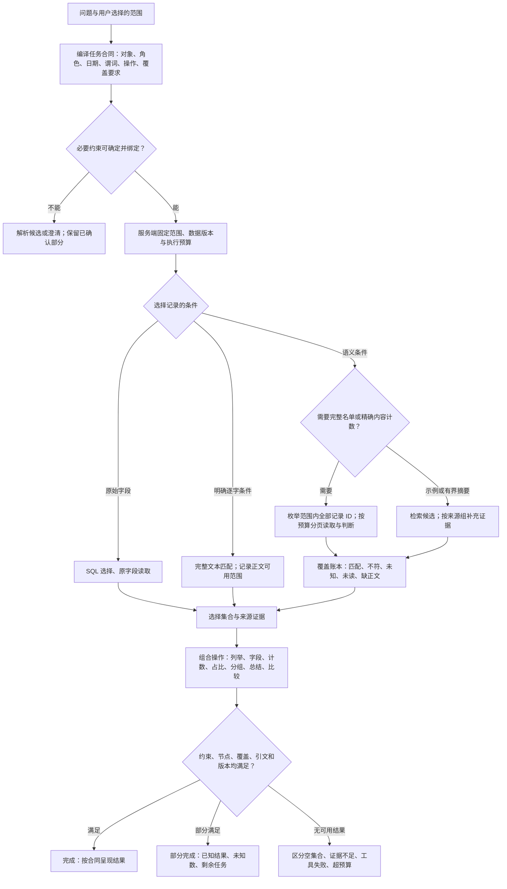

# RAG 决策树与主流程改造提案

日期：2026-10-15。状态：建议，尚未实现。依据：[独立根因复盘](rag_root_cause_review_20261015.zh-CN.md)。

## 1. 改造范围

建议大改**问题解释、计划编译、执行状态和完成判定**，复用数据库、实体解析、可信筛选交集、混合检索、来源版本、引文验证和预算账本。

现有 `question_intent.py` 已有类型化任务结构，应升级并贯通这套结构。新增第三套规划器、再增加一个平行 agent 或立即迁移框架，都不能自动修复现有合同断点。单纯打开现有 intent 开关也不够：它仍有组合限制、约束漏绑定和 `answer_shape` 传递缺失。

核心变化：将“统计、名单、比较、解释”从互斥路由变成可以组合的操作。决策树负责判断数据和证据需要满足什么条件，执行计划负责保存每个子任务。

## 2. 必须补入决策树的判断

| 新判断 | 必须回答的问题 | 未满足时的行为 |
| --- | --- | --- |
| 名称的角色 | 它是赞助方、媒体、账号、文章定位，还是正文谈论的对象？ | 查角色和候选；只澄清会实质改变结果的歧义 |
| 范围绑定 | 问题中的集合、日期、必要实体、并／交关系是否都落实？ | 不允许省略后继续全库搜索 |
| 任务组合 | 用户同时要名单、字段、计数、占比、分组、比较或解释吗？ | 为每项保留节点和依赖，不能搜索一次就结束 |
| 谓词类型 | 是字段相等、逐字匹配、语义提及、框架、立场还是修辞？ | 用相应判据，无法确定时保留未知 |
| 覆盖承诺 | 要几个例子、指定记录，还是全部匹配项／准确数量？ | 决定能否使用 top-k 作为终止条件 |
| 数据资格 | 总记录、可计数记录、有可读正文记录各有多少？ | 缺正文保留未知，不当成负例 |
| 阅读充分性 | 支撑和反证是否已读，剩余原文会不会改变结论？ | 补读或标 unknown；不把候选数当已读全文数 |
| 多组覆盖 | 每个公司、时段、集合是否完成各自要求？ | 缺组返回 partial，不能用另一组替代 |
| 完成与预算 | 所有必要节点是否完成，数据版本是否一致？ | 给出部分结果和剩余项；预算耗尽不等于来源不存在 |
| 库外补充 | 当前任务是否允许外部信息，外部信息能回答哪一部分？ | 独立标来源；不能补齐库内名单或统计分母 |

例如，“哪些广告提到 Larkspur Energy”中的名称是内容对象；“Larkspur Energy 发布的广告”才可能是所有者筛选。这一差别需要绑定角色，不能把所有名字都硬塞进 sponsor。

## 3. 建议的主决策树



外部补充为独立来源通道，按现有用户许可和预算政策运行。它可以增加背景说明，但不改变库内选择集合或将 partial 改成 complete。

## 4. 一个统一的任务合同

在现有 intent schema 上扩展，不要求照抄以下字段命名：

```text
QueryPlan
  question + source_spans
  trusted_scope
    datasets, UI filters, snapshot/version
    counting_unit_by_dataset, date_basis, timezone, trusted_reference_time
    interval_endpoints, date_provenance, unknown_date_policy
  bindings[]
    original_span, semantic_role, canonical_ids, resolution_status
  selections[]
    scope_id, predicate_tree, coverage_requirement
  operations[]
    select / project / count / ratio / group_by / summarize / compare
    dependencies, required_fields, required_groups
    ratio: numerator_selection_id, denominator_selection_id, zero_denominator_status
  budgets
    interpretation, repairs, deterministic_reads, semantic_calls
    money, time, maximum_records
  unresolved_constraints[]
```

应坚持以下不变量：

1. **所有必要条件都有归属。** 原文片段被包含在 `question_part` 中，不证明片段中的实体、时间或操作已落实。每条有实质影响的约束必须绑定到范围、谓词或操作，或明确标 unresolved。
2. **执行器派生参数。** 模型提出语义计划；服务端从已验证的合同生成工具参数。fallback 可以调整查询词和读取次序，但必须继承合同。
3. **同一集合可服务多个操作。** `SelectionResult` 固定 ID 集合及来源版本，针对同一条件的 `count` 与 `list` 不应各做一次不同的检索再给不同结果。占比必须保留独立的分子与分母选择集合、计数单位及零分母状态，不能为统一集合而抹掉现有分母范围保护。
4. **组合关系显式。** 并集、交集、分组和比较分别建模。内容搜索只能完成当前节点，不能清空独立计数或原字段读取。
5. **失败原因保存。** 步数用尽、读取失败、缺字段、来源不存在、确实没有匹配项，不能合并成同一种“没有答案”。
6. **时间有可信锚点。** “上个月”等表达按服务端 reference_time 和时区解析；日期区间包含端点的约定、原日期与推断日期依据都保留在合同中。

纯虚构示例：

> 列出 Larkspur 与 Marigold 在 2021 年谈到潮汐电池的广告，分别计数，并比较两家对成本的表述。

编译为 `范围选择 → 语义筛选 → 按公司分组 → 列出 + 计数 + 比较`。若只完成第一家，保留其结果并标第二家未完成；不能只检索每家 3 篇就声称完整回答。

## 5. 完整集合：把 top-k 移到调度层

### 5.1 枚举与检索分工

- SQL 负责在同一快照下枚举全部满足元数据条件的记录 ID，稳定排序并分页。
- 检索负责优先阅读最可能相关的记录，帮助快速交付已有结果。
- 对完整语义名单，未读的尾部仍在账本中。连续无命中可以影响是否继续投入预算，不能证明尾部全为负。
- 来源缺正文、只有部分媒体文本、未索引等状态必须分开；完整索引也只证明保存语料完整，不能宣称原网页或视频事实全可见。
- 小范围任务直接按 ID 读取，不能通过增加检索 limit 来模拟枚举。

### 5.2 覆盖账本

```text
SelectionResult
  scope_id, snapshot_id, predicate_version
  enumerated_record_ids + enumeration_complete
  countable_count, readable_count, missing_text_count
  per_record[]
    source_version, all_chunk_ids, read_chunk_ids, unread_spans
    decision: match / nonmatch / unknown / not_read
    positive_evidence[], counter_evidence[], unknown_reason
  completed_operation_ids, pending_operation_ids
  completion_status, stop_reason
```

设匹配为 M、不符为 N、不确定为 U、未读为 R、缺正文为 A。每条枚举记录只能归入一个最终状态，数量满足 `scope = M + N + U + R + A`；缺正文记录不再重复计入 U。中间读取状态可以更细，但汇总必须互斥。

当枚举完整但仍有未知时，可以报告：

> 已确认 12 篇符合；另有 3 篇判定不明、5 篇未读、2 篇缺正文。

若必须给数值范围，算法状态下的范围为 `[M, M+U+R+A]`，**前提是当前 match／nonmatch 判定被接受**；它不是包含语义误判不确定性的统计置信区间。对未完成枚举的范围，连上界都应保留未知。

### 5.3 完成标准

- **示例任务：** 满足所需来源组、证据和数量即可完成，明确其为示例。
- **完整名单／精确语义计数：** 枚举完整，全部来源具备所需证据，各条完成规定判定，无 unknown／未读／缺正文，再给算法意义上的 complete；同时说明语义判断来源与审核状态。
- **比较：** 每组满足自身覆盖合同，再比较相同维度。摘要可以是有界样本比较，但不能伪装成全体差异。
- **原字段／统计：** 使用指定版本、日期依据、单位和分母；模型不能修改结构化结果。

## 6. 语义判断：把判据和证据结构做清楚

### 6.1 区分不同问题

| 条件 | 所需判断 | 典型边界 |
| --- | --- | --- |
| T0 原字段 | 指定版本的原始值 | 缺值与推断值分开 |
| T1 提及 | 逐字还是语义提及，允许哪些变体 | 身份词、动词变形、同义词不能混用未声明的标准 |
| T2 框架／定位 | 某对象是否被赋予指定功能、价值或必要性 | “有帮助”不自动等于“不可或缺” |
| T3 立场 | 谁对什么表示支持／反对，力度如何 | 引述他人、描述争议、否定和自身立场分开 |
| T4 修辞 | 是否形成规定的表达／论证关系 | 单个相关词或一个产品例子未必构成总体叙事 |

这些类别应映射到通用语义结构，不依赖某一道 B1K 题或某个客户主题。判据版本在评估前冻结，允许疑难项保留 disputed。

### 6.2 建议的文章级输出

返回短而可审核的结构：`actor / relation / object / modality / stance / evidence_spans / counter_spans / decision / reason_code / coverage_status`。不要求自由输出冗长推理。

- 正例：引文确实存在，并对准该条件；多句共同支持时允许多个原文位置，避免为了“一句话”丢掉必要关系。
- 负例：区分明确反证与完整阅读后未发现；未充分阅读不能给出全文否定。
- 未知：区分文本缺失、角色不清、判据边界、证据矛盾、处理失败。下一步由未知原因决定。
- 长文：按 token 预算阅读，保留临近段落和跨段关系，再合并到记录级。固定每批文章数不能代替上下文预算。
- 稳定性：固定记录标识和排序；记录原文／完整请求哈希、模型配置和 rubric。对冲突做受限复判；缓存保存可复现结果，不掩盖语义错误。

### 6.3 需要更大改动时

如果目标是高频、全库、低延迟语义查询，可以建立版本化的离线证据索引：针对固定属性提取命题和证据位置，带来源版本及审核状态；查询时先查索引，再补读不覆盖的自由条件。未审的 AI 提取只是候选证据，不能自动变成批准的 CLAIMS 标注或 gold。先测实际重复查询量、成本和漏召回，再决定是否值得建设。

## 7. 预算与失败处理

现有固定四步同时消耗在计划、解析、修复和工作上，导致某些合法组合先天不可完成。应保留总体费用／时延硬上限，同时分开预算：

1. 一次解释和少量有理由的语义修复。
2. 服务端可确定的实体解析、分页、原文读取。
3. 可计费的内容判断和总结。
4. 明确的剩余节点、读取游标与停止原因。

编译时检查预算内能否执行。解析到跨类型同名来源但没有剩余步骤时，应标“解析未完成”，不能报告“库里没有”。后续继续执行也必须使用相同范围和版本，或明确重新开始。

## 8. 实施顺序与验收

| 阶段 | 具体改动 | 先做的免费验证 | 效果验证 |
| --- | --- | --- | --- |
| P0 测量修正 | 冻结共同参考；区分精确集合与门槛通过；统计／字段结构化判分；拒答与失败分开 | 重放历史结果，保留原成绩；给评分器注入否定、无关数字、服务失败反例 | 新参考版本同时重评各版本，争议率单列 |
| P0 合同止血 | 保留复合计划剩余节点；传递并统一 answer_shape；所有入口检查明确范围；fallback 保持合同 | 新虚构实体／日期／组合反例；含“提到某公司”角色负例、相对日期和区间端点、独立分子分母及零分母 | 在独立题上测范围正确率及操作完成率 |
| P1 集合执行 | 同快照枚举 ID；小范围按 ID 读取；阅读账本；partial／unknown 分开 | 30/31 条边界、120 条以上、稀有末尾正例、缺正文、分页重复／遗漏、版本变更 | 完整集合一致率、成员 P/R、未知率、成本及延迟 |
| P1 统一计划 | 升级现有 intent；证据成为普通节点；选择、聚合、比较可组合；分开预算 | 选择后计数、分组比较、内容解释加独立统计、第二节点失败 | 同一冻结数据与预算下比较旧／新路径 |
| P2 语义阅读 | 通用判据、证据与反证、长文合并、按 token 批处理 | 长于 3/8 段、跨段指代、否定、引述、愿景与完成、批次排列 | 固定输入重复；分别改变 batch、rubric、effort，保留全部结果 |
| P3 性能与预计算 | 仅为实际高频谓词建立版本化证据索引 | 版本失效、缓存键、未审标签隔离、缺项回退 | 留出语料的时延／成本／准确率权衡 |

不同时更换模型、提示、候选范围、参考和评分阈值后再报告一个总分。先固定测量，单独验证关键机制，再做整条流程对照。工程实现完成后运行项目要求的完整检查；本轮文档审计未运行、也不冒充该工程验收。

迁移可逐项完成：先修明确控制流错误；新编译器离线影子运行；接入选择集合与覆盖账本；最后切换默认入口。保留旧路径用于冻结对照，避免新增两套永久互相解释任务的逻辑。

## 9. 新评估应覆盖什么

- **合同：** 角色、实体、时间、单位、日期依据、语言、所有操作是否保留。
- **集合：** exact set、逐题和总体 P/R、未知／未读数量、每个组的覆盖。零正例、真实实体困难负例和缺正文应有足够案例。
- **内容：** 每个事实是否有原文支持、必要信息是否足够、有没有额外错误、引用定位是否正确。预置某几个点不是唯一正确回答。
- **可靠性：** 完整请求一致时的输出变化；同文不同批次的敏感性；失败是否保留部分结果。
- **效率：** 总费用、每篇处理费用、尾延迟、重试、缓存命中和完成比例。
- **泛化：** 旧 B1K 为回归集；另用新来源／时间、不同表达和通用判据组合建立留出集。来源列表为空产生的 `source_seen_before=False` 不能证明材料未见。

目标通过线在新实验前约定，不从本次失败反推；客户验收条件仍需独立确认。当前建议已足以开始免费工程修复，不需要先靠扩大付费重跑寻找所有控制流错误。
