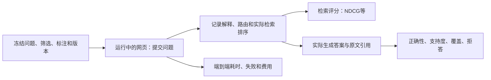

# RAG检索与实际回答评价

更新：2026-10-08。客户要求：C13／C14，用户明确确认转述。**P59已完成一轮18题本机真实问答试点及12题检索诊断，见[审核报告](../../.runtime/rag_eval_test_20261008/root/report/overview.html)。** NDCG@5关键词0.6823、向量0.8702、混合0.7801；140个判断为AI辅助，前五全判，不是人工准确率或客户验收。K、标注等级、样本数和工具选择是团队实施方案，不是客户已批准的阈值。

## 1. 分开回答三个问题

| 层次 | 要判断什么 | 主要依据 |
| --- | --- | --- |
| 检索 | 能否找出相关材料，并把更有用的材料排在前面 | 问题—来源相关性标注与实际有序结果 |
| 回答 | 是否答对、答全，引用是否支持所说的话 | 冻结答案要点／统计真值、原文、逐项支持判断 |
| 实际运行 | 用户从网页提交后，整条链路是否有效 | 指定运行版本、入口、响应、日志、延迟与费用 |

NDCG高不证明回答正确，字符匹配不证明引用支持结论，能检索到帖子不证明它是付费广告。

## 2. P58准备时发现的缺口与P59进展

以下保留准备时的诊断。P59已增加`scripts/score_retrieval_run.py`，隔离安装`ir_measures`，完成真实候选／文章选择／生成上下文捕获以及实际Dash HTTP测试；50项全新虚构评分器检查通过。不是在公共Railway版本测试，也不把小试点当作完整基准覆盖。

- `src/observatory/evaluate.py`保存问题、筛选、指定来源、原句及返回证据；旧`hit_at_5`要求**全部指定来源**出现在前五篇，属于完整来源命中检查，不是标准的“至少命中一个”，也不是NDCG。
- `metric_statistics.set_result`已有完整集合的precision／recall／F1；这是无排序的集合指标，不可当成排序分数。
- 现有评价缺少分级相关性表（qrels），未发现NDCG、MRR或分级排序评分器。选定项目Python环境也未安装`ir_measures`、`pytrec_eval`或`ranx`。
- 免费`Service.search/search_report`与MCP的`search_records`走关键词检索。实际回答分支`Service._answer_evidence`会生成查询向量并做混合检索。两条路径必须分别标记，不能用免费关键词测试代表真实混合检索。
- `Evidence.retrieval_rank`是集合内的片段名次，不是全局文章展示名次；文章内片段还会按原文位置排列。文章级评价按实际输出首次出现顺序去重，不能把这个字段直接全局排序。
- 现有评价在进程内创建`Service`。它可以检查业务逻辑，但不经过已运行网页；实际服务测试适配与分阶段排序捕获仍待实现。

## 3. 测试数据怎么建

使用客户已交付的原生广告、社交帖子及可核对的附件作为语料，不另造一套假语料代替实际评价。客户若已有查询—文档相关性标注，先核对其定义、原文身份、版本和标注来源再复用。**只有文章、旧CLAIMS标签或标准回答，不等于已经有检索相关性标注。**

没有现成标注时，由团队独立构题：可以先做60题试点（20原生内容、20社交内容、10跨集合内容、5统计、5已核实无答案题）。这是工作量建议，结果只代表该样本；统计与无答案题不混入NDCG均值。正式样本量依试点方差和需要比较的差异确定。

- 题目来自真实使用任务或独立查看语料后的构题，覆盖精确名称、同义表达、多个条件、比较、限定／反驳、中文与英文。
- 保存构题来源和曝光历史。开发与独立报告分组冻结，来源文章／近重复组及构题模板避免跨组泄漏；共同的检索语料仍可保留在索引中。
- 客户24题继续只用于评价，不从其问题、参考、改写或逐题输出构建开发题。本要求不自动恢复已取消的24题全量人工标注。
- 将关键词、向量、混合检索的候选取并集，加入独立查找的相关来源和少量随机／易混淆材料；随机顺序、隐藏候选所属系统再判断。不能只标当前系统已检索到的结果。
- AI可协助初标；逐项记录`human`、`ai_assisted`、`rule_derived`及实际复核状态。抽查各等级、数据集和分歧项，保留未复核状态；抽样确认不能把全部标签改记为人工金标准。

### 相关性等级

| 等级 | 定义 |
| --- | --- |
| 3 | 符合问题范围，直接提供所需证据，保留关键主体、时间和限定；直接反驳问题假设的证据也可以是3 |
| 2 | 对所问内容有实质帮助，但只能回答一部分或需要额外上下文 |
| 1 | 主题相关，仅提供背景，不能据此回答该问题 |
| 0 | 不相关，或公司、日期、集合等范围不符 |
| 未标注 | 尚未判断，不能直接改记为0 |

标注绑定问题、筛选、记录ID、版本及正文哈希。片段级另绑定chunk ID／字符区间；缺正文或版本不符标为不可判定。文章级判断看该篇可用材料；片段级只看实际返回片段及明确允许的上下文。旧主题标签不能直接替代这些等级。

## 4. 检索指标与计算口径

文章级主指标用 **NDCG@5**；运行前明确请求前10篇的阶段附NDCG@10。是否适用按预定阶段和K判断，不能按实际返回数量挑题；不足K、空结果和失败继续保留，缺失位置增益为0。片段级单列，不与文章级相加。只设计返回五篇的界面单报@5，另一个@10候选阶段不得冒充界面结果。比较组和原生／社交分别报告，再给注明组权重的汇总。

比较分支若预定每组只取三篇，则该组单列@3；不同K的结果不合并为同一个NDCG均值。所有截断点在运行前登记，不能为提高分数事后选择。

| 指标 | 计算与意义 | 边界 |
| --- | --- | --- |
| NDCG@K | 实际前K排序的折扣增益／同一标注集合的理想前K增益；越接近1，较高相关性的资料越靠前 | 是排序指标，不是正确回答的百分比 |
| Precision@K | 前K个位置中等级≥2的数量／K | 少于K个结果仍以K为分母；重复记录不重复得分 |
| Recall@K | 前K检索到的已标注相关来源数／该题所有已标注相关来源数 | 候选池不完整时只能称“已知相关来源召回率”，不能称全库召回率 |
| MRR@K | 首个等级≥2结果的名次倒数；前K没有则为0，再按题平均 | 用于定位来源任务；不能证明多来源问题已找全 |
| Judged@K | 前K个位置中具有明确相关性判断的数量／K | 与实际返回数一起展示；另报已返回结果的标注覆盖率 |
| 多对象覆盖 | 各指定对象是否至少有一项等级≥2的证据，分别报告并给全部覆盖率 | 用于比较题；一方大量命中不能替代另一方 |

为便于复用标准工具，冻结线性增益版本：

\[
DCG@K=\sum_{i=1}^{K}\frac{r_i}{\log_2(i+1)},\qquad NDCG@K=DCG@K/IDCG@K
\]

其中`r`取0–3；IDCG对**该题全部已标注候选**按等级降序排列后取K，不能只从本次命中的结果建立理想排序。采用`ir_measures`的`nDCG(dcg='log2')`／固定`pytrec_eval`后端，保存包版本；不用另一工具默认的`2^r-1`变体混算。官方实现依据见下方来源。

不完整标注的处理：

1. 前K含未标注材料时，记录`provisional`；可附标准工具把未标注作0的诊断分数，但必须显式说明。正式比较先补齐参评系统的候选池，不删除未标注结果再压缩名次。
2. IDCG为0的题目标为排序参考不可评分，NDCG不适用；已核实无答案题另进无答案组。二者分开报告，不能隐藏或相互替代。仅候选池中未找到相关项时，标为答案可用性未知，不能断言全库没有答案。等级全部≤1时，分级IDCG可能仍大于0，但二值相关来源数为0：Recall／MRR标为无可用正例参考、单报数量，不能让库的默认0分冒充全库召回结论。
3. 已知有相关材料但检索返回空、超时或路由错误，保留在预注册端到端检索分母中，质量贡献为0，并单列失败原因；另报成功检索请求的排序结果。没有参考的题只报未评分，不伪造0分准确率。
4. 同分时保留系统实际输出次序；TREC运行文件可用严格递减的`-rank`作为评分顺序，同时另存原始分数。每条排序使用独立`ranking_id`，对应阶段、关键词／向量／融合模式、比较组、集合和有效筛选；不能把不同组的rank=1拼成同一排名。评价时qrels必须对应这条排序的实际范围。不同分块方案需重新对齐原文证据或重标片段，不能拿旧chunk ID直接比较。

工具复用方案：离线评分采用`ir_measures`，记录NDCG、`P(rel=2)`、`R(rel=2)`、`RR(rel=2)`和Judged；先核对目标环境兼容性后安装。当前未新增运行依赖，也未实现/声称完成评分适配器。输入模板见[评价模板](../../templates/retrieval_evaluation/README.zh-CN.md)。

## 5. 真正运行后如何测试

每次保存部署URL、`healthz`返回的版本、Git提交／源码指纹、数据和索引版本、模型、提示／工具策略、配置、题集和qrels哈希、时间和request ID。缺可验证版本时标记未绑定版本，不能声称可复现实验。

先在同一范围比较关键词、向量及混合检索；记录原始候选、文章分散后的结果、最终传入生成器的上下文三个阶段。阶段顺序不得互相冒充。排序捕获不足时先补审计入口，不能从最后几条引文反推完整检索排序。

再通过实际部署网页的查询入口测试完整链路，保留提交问题及筛选、页面结果、对应服务日志。进程内Service测试、MCP关键词测试与部署网页测试单独命名。端到端测试保留路由错误；另用固定正确筛选做检索器诊断，不能只报告后者。

### 回答评分

| 项目 | 明确口径 |
| --- | --- |
| 统计正确 | 完整范围、单位、数量和分组与独立数据库参考一致；全部计划统计题为分母，另报已答正确率 |
| 证据支持率 | 有来源支持的可核查陈述数／全部可核查陈述数；“引文文字存在”与“支持这句话”分开检查 |
| 要点覆盖率 | 已正确回答的必需参考要点／全部必需参考要点；参考不完整时不称完整覆盖 |
| 列表P／R | 仅有完整名单参考时计算；语义列表不能按几个示例声称找全 |
| 回答覆盖与误拒 | 完成集合任务的题数／全部计划题数；可答题中被错误拒答的比例另报 |
| 无答案处理 | 已核实无答案题中正确拒答／限定回答的比例；集合未完成而给出网页补充不算完成集合任务 |
| 运行表现 | 端到端与各阶段p50／p95耗时、错误率、每题费用；超时数量与超时上限单列，不从延迟报告消失 |

关键词语义相似、LLM自评和AI参考一致率可以作为辅助结果，不能改称人工准确率。引用支持率的原始分子／分母与按题均值都保留，避免长答案主导汇总。没有可核查陈述的回答不记作100%支持；它的完成、拒答或失败状态继续计入相应分母。

## 6. 比较和验收

运行前冻结题目、数据、qrels、公式、K、重试规则和配置。每题一次主要尝试；重试另存，失败保留。比较前后同一批题的逐题差值；提供样本量、分层结果和按来源／近重复组抽样的区间估计。小试点只能发现问题，不能证明全库可靠。

客户尚未批准NDCG或回答指标的通过阈值；不预设“NDCG≥0.8就是通过”。先交基线、标注覆盖、改进量与失败实例，再确认可接受标准。正式交付同时包含版本、题集范围、标注来源、检索和答案结果、失败及可复现命令。

**当前状态**：规范、模板、标准评分器和有限试点已完成；12个内容题三通道评分、18次实际网页主要尝试及逐题审核可查。内容完成2/12，统计数值一致1/4但语言／范围仍不符；所有网页请求默认开启推断日期，与冻结输入不同。真实语义失败与范围差异保留，@10的32/36排序含未判项，不能只报告已判子集均值。59次API用量计价$0.19586049；主库只读、私有测试库有费用／缓存写入，已停止保留，无发布、无旧客户24题调用。公共部署版本验证、代表性扩大评价及客户验收仍待办。[完整审核目录](../../.runtime/rag_eval_test_20261008/root/README.zh-CN.md)；[任务台账](../../客户需求/03_执行计划/2026-10-08_RAG检索与实际问答评价.md)。

## 参考依据（2026-10-08核对）

- [ir-measures指标定义](https://ir-measur.es/en/latest/measures.html)：分级NDCG、可配置增益、Judged等。
- [NIST trec_eval的NDCG实现](https://github.com/usnistgov/trec_eval/blob/master/m_ndcg_cut.c)：线性相关性增益及log2位置折扣。
- [ir-measures输入格式](https://ir-measur.es/en/latest/getting-started.html)、[缺失查询处理](https://ir-measur.es/en/latest/advanced.html)：qrels、运行结果及逐题计算；库默认行为不能替代项目对未知标注和无答案题的解释。
- [Stanford：排序检索评价](https://nlp.stanford.edu/IR-book/html/htmledition/evaluation-of-ranked-retrieval-results-1.html)：排序与不完整相关性判断的区别。
