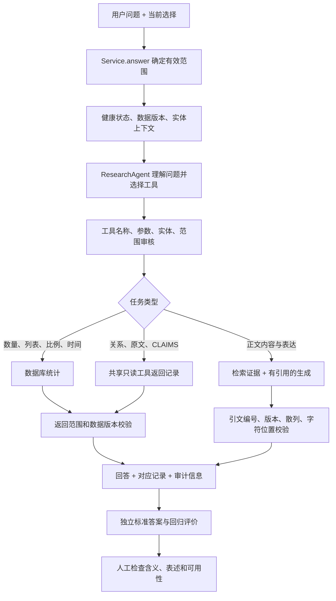

# Research Agent 审核程序技术报告

日期：2026-10-05（America/New_York）  
项目：CISS Advertising Observatory  
审查目录：`D:/Projects/549 native ads`  
对象：网页研究 Agent、共享工具目录、统计与证据校验、评价及客户审查流程。

## 1. Executive Summary

**已有自动审核程序；本次修复了两类漏洞，并补充了回归测试。人工语义审查和客户验收尚未完成。**

系统先让语言模型理解问题、选择工具，再由程序查询记录、计算统计值或生成有引用的回答。审核程序约束模型可以做什么、允许访问哪些记录、结果使用什么日期依据，以及引用能否定位到对应版本的原文。

本次完成：

1. 阻止模型或自定义适配器改变调用者已经确定的日期依据，例如把“仅原始日期”改为“包含补充日期”。
2. 修复统计评价器：返回结果必须包含完整、类型正确的筛选范围；缺字段不能靠默认值补齐后算作通过。带有故障标记的回答也不能获得统计通过。
3. 增加双向日期冲突、显式原始日期选择、缺字段、类型混淆、故障状态和合法零值的测试。
4. 保存基线、失败及最终测试回执，核查客户审查包和人工审查表。

本次没有调用真实模型或外部搜索，没有执行数据库评价、改动业务数据或部署。新增代码尚未提交。本报告不把离线测试成绩解释为模型准确率或客户认可。

## 2. Evidence and Scope

| 项目 | 本次依据 |
| --- | --- |
| 基础代码提交 | `7e2fdcb`；完整提交号见机器回执 |
| 源码声明版本 | `pyproject.toml`：`0.4.10` |
| 运行环境 | Python 3.12.14、Pydantic 2.13.5、pytest 9.1.1 |
| 生产代码修改 | `research_tools.py`、`structured_queries.py`、`evaluate.py` |
| 回归测试修改 | 六个测试文件，详见机器回执的 `changed_tracked_paths` |
| 机器证据 | [本次审核回执](agent_review_20261005_evidence.json)：代码字节散列、提交号、环境、测试、准备包及审查表状态 |
| 不在本次验证范围 | 真实模型路由准确率、当前线上数据库统计值、付费回答效果、客户可用性、生产部署 |

测试加载的是上述 D 盘目录的实际源码。安装包元数据不能替代源码版本，也不能据此推断线上版本。

## 3. Audit Workflow

### 3.1 Actual implementation



该图表达正常成功路径。参数无效、实体不明确、范围冲突、版本变化、预算不足或服务不可用，会进入澄清、限制或失败状态；不会把这些状态当作正确答案。

网页通过模型的 **function calling** 调用共享工具目录。`mcp_server.py` 将同一目录提供为可选 MCP 接口。MCP 是工具连接方式，审核逻辑在工具执行器与服务层；网页不依赖另一个远程 MCP 服务。

### 3.2 The four questions

| 用户关心的问题 | 当前系统怎样实现 | 自动审核的限度 |
| --- | --- | --- |
| Agent 接到任务后第一步做什么？ | 接收原始问题和有效筛选范围，检查健康状态，提供实体候选；提示词要求先区分统计、正文、关系、原文及 CLAIMS 查询 | 没有独立的结构化任务计划审核器，不能仅靠提示词证明模型完整理解了用户意图 |
| 怎样判断需要哪些信息？ | 使用 `active_scope`、`entity_context` 和可选参考日期；不确定实体可调用 `resolve_entity`；关系结构可读 `get_graph_schema`；信息不足则澄清 | 通用程序不能判断所有业务问题是否完整；分母、组织身份、分类含义仍需要明确的领域规则 |
| 怎样决定使用哪个工具？ | 只允许固定工具及其严格参数模式；最多四步、四次工具调用，每轮选择一个；收到终止工具结果即结束规划 | 工具合法不代表选择正确；例如要求比例却选择总数，仍需题目标准答案识别 |
| 怎样知道做得对不对？ | 参数与范围检查、数据库结果、版本检查、引用定位、独立标准答案及回归测试共同检查 | 引文存在不等于引文支持结论；模型解释、表达归属和客户是否能完成研究任务，需要人工与真实使用验证 |

### 3.3 Tool responsibilities

| 工具 | 主要用途 | 应保留的边界 |
| --- | --- | --- |
| `record_statistics` | 记录数量、媒体/赞助方列表、年度分布、时期比较、比例 | 数字来自数据库；没有可检索正文的记录仍可能属于计数范围；不能用检索前五条推断全库总数 |
| `search_records` | 当前范围内的正文证据检索 | 共享工具本身返回有限关键词结果；网页证据路径随后可做混合检索和生成；检索不证明完整覆盖 |
| `resolve_entity` | 根据实际来源名称找实体候选 | 别名用于定位；候选名称不能自动证明企业归属或合并身份 |
| `get_graph_schema` / `get_graph_neighborhood` | 读取有类型的关系及其来源 | 当前邻域最多返回五篇原生广告的一页关系；该页不能作为完整总体统计 |
| `get_record` / `get_record_sources` | 读取指定记录原文及来源材料 | 使用记录和版本标识；不允许任意路径或网址读取 |
| `get_claims_matches` | 读取已发布的 CLAIMS2 分类及证据 | 未匹配不等于阴性；分类结果不等于事实核查或已证实的漂绿 |

可选外部搜索独立标注为外部来源，不参与库内广告数量计算。MCP 的公开研究搜索与旧 CLAIMS 来源补查是不同用途；来源候选不能自动升格为已审核记录。本次没有启用或测试真实外部搜索。

## 4. Changes Made

### 4.1 Preserve the trusted publication-date basis

**原问题：** `ToolCatalog.narrow()` 曾允许模型直接修改 `include_inferred_dates`。即使公司和媒体筛选没变，日期含义和进入结果的记录仍可能改变。

两种修改方向都需要阻止：

- 原始日期 → 包含补充日期：原来没有原始日期的记录可能进入指定时期。
- 包含补充日期 → 原始日期：在“缺日期”查询中，原来有补充日期的记录可能重新进入结果。

因此，不能把某个布尔值方向简单看成永远“缩小范围”。

**修复：**

- `research_tools.py` 的参数说明要求保留有效范围中的日期依据；省略或传入相同值可继续。
- `ToolCatalog.narrow()` 拒绝不同值，返回范围冲突澄清。
- `structured_queries.validate_share_scope()` 同样检查日期依据，保护服务层、自定义研究适配器、证据比较适配器和比例范围。
- 服务边界测试确认：冲突发生时，不进行后续检索、embedding、预算预留或生成。该服务边界当前返回不可用状态；工具目录直接调用返回澄清。

本次没有改变 `Service.answer()` 的现有默认行为：调用者省略这个字段时，服务默认包含补充日期；调用者显式指定 `False` 时，保留“仅原始日期”。**锁定的是规范化后的有效范围，不是模型自己选择的默认值。** 若用户要换日期依据，应先明确更改调用范围。

### 4.2 Require complete statistics scope evidence

**原问题：** 统计评价器通过 `Filters.model_validate()` 读取返回范围。返回 `{}` 或省略字段时，Pydantic 会补默认值；在部分默认范围案例中，缺少范围证据的结果也可能通过。回答即使带有故障原因，只要状态与数字看似正确，也可能被计为正确。

**修复：** 新的 `serialized_filters_match()` 要求：

1. 返回值是字典，字段集合与完整预期范围完全一致。
2. 字符串列表必须是字符串列表，按筛选集合比较；不依赖列表顺序。
3. 标量值与类型一致；不把字符串、整数或布尔值相互转换后接受。
4. 统计通过同时要求成功状态、没有故障原因、数据库统计路径及正确的逐数据集总数。

**合法零值仍可通过。** 零条记录与数据库失败、实体不明确、数据集未接入是不同状态。该检查只证明返回范围和统计契约匹配，不能证明模型理解了题目或标准答案本身正确。

### 4.3 Update fixtures without weakening guards

首次全量测试中，十个旧测试替身返回“仅原始日期”，但调用服务时省略字段，服务实际采用“包含补充日期”。新检查正确阻断了不一致的返回值。

本次修正了模拟成功结果的有效范围，并新增五项服务边界案例：两种适配器 × 两种日期修改方向，以及显式原始日期选择。没有为了让测试通过而删除范围检查，也没有修改应用默认日期行为。

## 5. Evaluation and Human Review

沿用现有评价工具，不新增一个替代人工的模型裁判。

### 5.1 Existing layers

| 层级 | 已有工具 | 能回答的问题 |
| --- | --- | --- |
| 离线工程回归 | pytest、Ruff | 无效参数、范围扩大、日期冲突、版本漂移、故障路径是否被正确处理？ |
| 开发自测 | `scripts/run_selftest.py`、`eval/selftest/` | 数据库规则结果和检索命中是否匹配开发题标准？ |
| 真实用户题目 | `eval/user_questions/` | 不同表达、简称、时间与客户研究问题是否被正确处理？ |
| 独立证据评价 | `observatory.evaluate` | 标准支持原句能否检索到？统计回答是否符合预期范围？ |
| 冻结与准备检查 | `scripts/prepare_client_review.py`、冻结清单 | 题目、支持证据、文章分组、来源版本和审查声明是否齐备且保持一致？ |
| 人工语义与使用审查 | 审查 CSV、审查者与批准记录 | 引文支持解释吗？表述会误导吗？用户能找到所需记录吗？ |

开发自测有 24 个统计问题和 7 个检索主题，各含三种表达。它们是开发检查，不是独立验收集。38 个用户问题中，4 个来自客户已见示例，应与其余 34 个分开报告。内容题的关键词相关记录标准也不能替代逐条语义判断。

冻结机制绑定题目、金标准、文章分组、来源/索引版本和文件散列。运行期间版本变化会使结果失效并保留记录。前后版本检查不是跨所有服务调用的同一数据库事务快照。

### 5.2 Current readiness

客户审查包 `eval/client_review_20260925` 当前返回 `pending`，十项阻塞如下：

1. 缺审查者。
2. 缺批准记录。
3. 缺题目来源说明。
4. 缺验收标准。
5. 未确认代表性任务已经批准。
6. 未确认题目没有用于调参。
7. 未确认文章分组经过检查。
8. 缺有效的预期数据版本。
9. 没有客户问题与标准答案。
10. 候选集中 50 个记录未具备所需文章分组。

当前问题 JSONL 为空，文章分组表只有表头。准备器返回非零退出码是正确的阻塞行为，不应改为成功以继续验收。

本次检查到的审查文件：

| 文件 | 状态 |
| --- | --- |
| 客户包 `answer_review.csv` | 只有表头，零行 |
| `user-questions-review-20261001T154659Z.csv` | 38 行，审查者和最终 verdict 均为空 |
| `user-questions-review-filled-20261001T160015Z.csv` | 38 行，其中 31 行填写了 `correct`，审查者和最终 verdict 均为空 |
| 七份 `citation_review*.csv` | 共 132 行，`human_verdict` 均为空 |

文件名含 “filled” 或有机械正确性字段，不等于具名人工批准。这一结论仅覆盖本次检查的本地文件，不推断仓库之外是否有其他审查记录。

## 6. Verification Results

| 检查 | 实测结果 | 证据 |
| --- | --- | --- |
| 修改前相关测试 | 278 通过，0 失败 | [基线 JUnit](agent_review_20261005_baseline.junit.xml) |
| 首次全量回归 | 2237 通过、10 失败、3 跳过、10 预期失败；92 未选中 | [保留的首次失败 JUnit](agent_review_20261005_full_initial.junit.xml) |
| 夹具修正后的全量回归 | 2250 通过、2 失败、3 跳过、10 预期失败；92 未选中 | [保留的第二次失败 JUnit](agent_review_20261005_full_retry1.junit.xml) |
| 附件测试单独复查 | 33 通过、1 跳过；两项重命名失败未重现 | [附件复查 JUnit](agent_review_20261005_asset_check.junit.xml) |
| 最终全量离线回归 | **2252 通过、0 失败、3 跳过、10 预期失败；92 未选中**，pytest 总耗时 93.56 秒 | [最终 JUnit](agent_review_20261005_final.junit.xml) |
| 修改文件与采集脚本 Ruff | 通过 | [机器回执](agent_review_20261005_evidence.json) `quality_checks` |
| `git diff --check` | 通过 | 同上 |
| 客户准备包本地检查 | `pending`，10 项阻塞，退出码 2 | 同上 `review_packet_check` |
| 实际模型/API、数据库评价、生产部署 | 本次均未执行 | 同上运行范围声明 |

两次失败记录均保留：第一轮来自旧模拟范围不一致；第二轮是附件目录重命名的 Windows `WinError 5`。后一问题单独复测未重现；没有定位占锁进程，不能断言由杀毒软件或其他特定程序造成。本次没有修改附件打包代码或吞掉异常。

JUnit 把预期失败也列入 `skipped`。回执中的 13 项包含 10 个 `xfail` 和 3 个普通跳过，不能写成“13 项普通跳过”。未运行的 integration/live 检查也不能计为通过。

最终无非预期失败；十个已知预期失败仍保留为开发缺口，没有改成跳过或算作通过。这些结果验证工程约束与失败处理，不构成真实模型准确率、语义支持率、CLAIMS 正确率或客户满意度结果。

## 7. Reproduce and Operate

在项目目录、使用项目虚拟环境执行：

```powershell
# 免费离线回归；不访问真实模型或数据库
.\.venv\Scripts\python.exe -m pytest -q `
  -m 'not integration and not live' `
  tests eval/client_review_20260925/test_prepare_client_review.py

# 客户包本地准备检查；缺材料时应返回 pending 和非零退出码
.\.venv\Scripts\python.exe -X utf8 scripts/prepare_client_review.py `
  --packet eval/client_review_20260925
```

后续进行数据级检查时，先准备独立标准答案与版本绑定，再运行无模型的数据库规则/关键词检查。正式付费 Agent 检查必须明确使用付费模式，并保留模型、提示词、代码、题目、金标准、数据/索引版本、成本与失败记录。不能用免费规则通过代替真实模型路由通过。

新的客户问题、会议或邮件进入需求流程后，应先记录来源和预期行为，再分配到统计、关系、正文证据或分类结果的验收项。已用于调参的题目留在开发集；正式验收应使用独立题目和文章分组。

## 8. Remaining Work and Acceptance

| 后续工作 | 完成判断 |
| --- | --- |
| 真实模型任务理解与选工具测试 | 同一冻结题集上，统计、比例、时间比较、跨公司内容比较、歧义澄清的实际路由与标准结果均有回执；失败也进入分母 |
| 语义支持与自然语言审查 | 具名审查者逐条确认回答含义、引文支持、限制说明和可用的下一步；不能仅检查字符匹配 |
| 客户准备包 | 十项阻塞解除，原文与分组检查通过，生成新的冻结包；此时仍只是准备完成 |
| 人工审查结果汇总 | 现有模板用于记录；尚未实现严格的 CSV 结果合并和总体验收汇总。补齐时应绑定 case/run/version、检查完整性与重复，不伪造审查身份 |
| 社交广告研究问题 | 正式数据及字段说明接入后，补数据级和用户级验收；缺数据不得借原生广告结果替代 |
| CLAIMS 查询 | 明确分类版本、发布状态及证据；正例、未分类、历史自动结果与事实核查分别呈现并接受审查 |
| 客户可用性 | 客户能完成“NYT 有多少条”“ExxonMobil 对应哪些媒体”“Washington Post 对应哪些赞助方”等任务，并打开对应记录；这不能仅由单元测试判定 |

**完成状态必须分开记录：**

- 工程完成：指定回归与静态检查通过，改动及失败证据可复查。
- 真实模型验证完成：独立输入、实际 API、标准答案和可复现运行记录齐备。
- 客户验收完成：具名审查与实际任务确认齐备。

当前只有第一层具备本次工程验证。评价程序继续保留 `semantic_support = pending_human_review` 和 `overall_pass = null`，直到后续证据足以支持相应结论。

## 9. Code References

| 文件 / 入口 | 职责 |
| --- | --- |
| `src/observatory/service.py:454`，`answer()` | 确定有效日期依据，选择回答路径 |
| `src/observatory/service.py:562`，`_answer_with_tools()` | 健康与版本检查、共享工具规划、结果路由及审计 |
| `src/observatory/research_agent.py:344`，`run()` | 有界模型工具选择、参数大小/次数限制、工具轨迹 |
| `src/observatory/research_tools.py:275`，`narrow()` | 可信范围交集与日期依据锁定 |
| `src/observatory/research_tools.py:381`，`call()` | 工具白名单、严格参数、实体及版本检查 |
| `src/observatory/structured_queries.py:329`，`validate_share_scope()` | 分子/分母及其他服务路径的范围保护 |
| `src/observatory/rag.py:550`，`validate_answer()` | 引文目录、来源版本和字符位置校验 |
| `src/observatory/evaluate.py:516`，`serialized_filters_match()` | 完整范围证据的严格比较 |
| `src/observatory/evaluate.py:532`，`count_answer_checks()` | 数据库统计答案状态、范围与数字评价 |
| `src/observatory/mcp_server.py` | 共享工具的可选 MCP 传输 |
| `scripts/prepare_client_review.py` | 准备检查和冻结清单生成 |
| `reports/reviews/agent_review_20261005_capture.py` | 本次离线审查证据采集；不会覆盖已有回执 |

